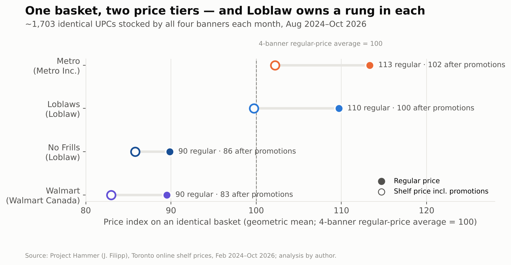

# Same Owner, Different Shelf: a consumer-behaviour perspective on Canada's grocery oligopoly

*Independent research project · University of Toronto*
**Topics:** quantitative analysis · pricing strategy · market structure · executive presentations · Python & Excel

Canada's grocery sector is dominated by a few parent companies. Each runs a portfolio of banners spanning discount, conventional and premium segments. This project uses **76.8 million daily shelf-price observations** for eight Toronto banners ([Project Hammer](https://jacobfilipp.com/hammer/), Feb 2024 to Oct 2026), matched product by product. Statistics Canada CPI and average retail prices supply the context. The question is whether these firms behave like independent merchants competing item by item, or like portfolio managers segmenting shoppers by value proposition.



## Key findings

| # | Finding | Evidence |
|---|---|---|
| 1 | **Two price tiers, one basket.** The conventional banners (Metro 113, Loblaws 110) sit about 20 index points above the discount banners (No Frills 90, Walmart 90), and Loblaw owns a banner in both tiers. | ~1,700 identical UPCs per month, `03b_banner_index_overall.csv` |
| 2 | **The banner is a price signal.** The same SKU costs a median **12.5% more** at Loblaws than at sister banner No Frills; 78% of 16,863 SKUs are dearer there, own brands included. | `02_identical_item_gaps.csv`, `02b`, `02d` |
| 3 | **Rival conventional banners share price points.** Loblaws and Metro charge the identical regular price on **40%** of matched item-days (Loblaws–Walmart: 0.1%). Paired changes land on the identical new price 29% of the time. | `02_identical_item_gaps.csv`, `05b_…csv` |
| 4 | **Timing coordination lives inside portfolios.** Loblaws–No Frills price changes are synchronised **1.9×** chance. The main rival-owner pairs show 0.9× to 1.4×, no higher than an out-of-market control. There is no consistent price leader, and changes follow a Thursday flyer cycle. | `04_synchronisation.csv`, `05_lead_lag.csv`, `11_change_weekday.csv` |
| 5 | **Promotions manage price image.** Conventional banners promote 26–34% of product-days (No Frills: 14%), trimming their basket by ~9–10% without closing the gap to the discount tier. | `07_promotions_by_banner.csv`, `03b` |
| 6 | **No visible holiday price freeze.** The Nov 1–Feb 5 "industry practice" freeze does not appear on the shelf: in-window increase rates are 0.84× to 1.09× the rest of the year, with no significant difference. | `06b`, `06c` |

Interpretation, implications and limits are in the deliverables. Shared or synchronised prices are **descriptive evidence**: they are consistent with coordination but also with common supplier costs and suggested retail prices. Nothing here is a finding of collusion.

## Deliverables

| File | What it is |
|---|---|
| [`deliverables/research_memo.md`](deliverables/research_memo.md) (+ `.docx`) | Client-facing research memo: findings, consumer-behaviour interpretation, recommendations, limits |
| [`deliverables/executive_presentation.pptx`](deliverables/executive_presentation.pptx) | 17-slide executive deck with native, editable charts and speaker notes |
| [`outputs/grocery_oligopoly_analysis.xlsx`](outputs/grocery_oligopoly_analysis.xlsx) | Excel workbook: 15 sheets, live formulas (AVERAGEIFS / SUMIFS / ratios), charts, audit tables |
| [`outputs/figures/`](outputs/figures) | 10 publication figures |
| [`outputs/tables/`](outputs/tables) | Every analysis table as CSV (the single source for all numbers in the memo and deck) |

## Data sources

| Source | Use |
|---|---|
| **Project Hammer** (Jacob Filipp), daily scrape of Loblaws, No Frills, T&T, Voilà, Metro, Walmart, Galleria and Save-On-Foods websites; in-store-pickup prices for a Toronto neighbourhood. [jacobfilipp.com/hammer](https://jacobfilipp.com/hammer/) | Banner × product × day prices, regular vs promotional |
| **Statistics Canada Table 18-10-0004-01**, CPI, monthly, NSA. [doi.org/10.25318/1810000401-eng](https://doi.org/10.25318/1810000401-eng) | Inflation context and validation |
| **Statistics Canada Table 18-10-0245-01**, monthly average retail prices. [doi.org/10.25318/1810024501-eng](https://doi.org/10.25318/1810024501-eng) | Benchmark prices for 10 staples |
| Competition Bureau, *Retail Grocery Market Study* (2023); corporate disclosures | Market-structure context; banner ownership |

Ownership coded in [`src/config.py`](src/config.py): Loblaw owns Loblaws, No Frills and T&T (acquired 2009); Empire owns Voilà (and Sobeys, FreshCo); Metro Inc. owns Metro (and Food Basics, Super C). Galleria is independent. Save-On-Foods (Pattison Food Group) does not operate in Toronto and serves as an **out-of-market control**.

## Method

```
data/raw (CSV) ──► src/build_panel.py ──► DuckDB: product_dim · daily (64.5M rows) · events
                                   │
                                   ▼
                    src/analysis.py ──► outputs/tables/*.csv
                                   │
           ┌───────────────────────┼─────────────────────────┐
           ▼                       ▼                         ▼
   src/figures.py          src/workbook.py           deck/build_deck.js
   (matplotlib PNG)        (xlsxwriter, formulas)    (pptxgenjs, native charts)
```

**Cleaning** (`src/build_panel.py`, logged in `00_cleaning_log.csv`):
- Parses multi-buy ("2/$7") and conditional deals ("sale $3.50 MIN 2") into an effective unit price.
- Repairs 123k cents-scaled prices.
- Separates the **regular** price (struck-through "was" price when on promotion) from the shelf price.
- Drops out-of-range values and collapses repeat scrapes to one row per banner-product-day.
- Excludes Sobeys (only 4 days of data).

**Matching:** shared SKU for Loblaws ↔ No Frills (one catalogue); normalised UPC/GTIN across owners; variable-weight items excluded.

**Measures** (`src/analysis.py`):
- **Identical-item gaps:** median daily log ratio per item, then summarised across items.
- **Basket index:** geometric mean relative to the four-banner average, on UPCs stocked by all four mainstream banners in the month.
- **Synchronisation lift:** share of persistent regular-price changes matched by the other banner within ±k days, divided by a time-shifted placebo (±2–6 months).
- **Persistent change:** not reversed within 14 days (a temporary-sale filter in the spirit of Nakamura & Steinsson, 2008).
- **Freeze test:** weekly increase rates inside vs outside Nov 1–Feb 5, Mann-Whitney U.
- **Promotions:** frequency, depth and co-timing lift.
- **Private-label share** of assortment and of promotion-days.
- **Chained matched-model inflation index** vs CPI.
- **Staple entry prices** vs StatCan averages.

**Validation:** banner regular-price indices rose 3.4–6.3% from Aug 2024 to Sep 2026, against 6.0% for StatCan's Ontario CPI for food from stores (`09d_inflation_summary.csv`).

## Reproduce

Requires Python 3.11+, Node 18+, pandoc (memo .docx) and ~6 GB of free disk.

```bash
cd grocery-oligopoly
make setup      # .venv + pip install -r requirements.txt; npm install in deck/
make data       # download Project Hammer (~520 MB zip, ~4 GB CSV) + StatCan tables; writes data/raw/MANIFEST.csv
make all        # panel -> analysis -> figures -> workbook -> deck -> memo (~10 minutes)
```

Project Hammer updates daily, so a fresh `make data` extends the panel. The tables, figures, workbook and deck are rebuilt from the new data automatically. The memo's prose quotes the October 2026 run.

## Limitations

- Online pickup prices for one Toronto neighbourhood; not a census of stores or regions.
- No cost or volume data, so margins and market shares are not observed.
- Cross-owner UPC matches for Loblaw banners rely on the source's fuzzy matching.
- Private-label and category flags use transparent keyword rules (`src/config.py`).
- Food Basics, FreshCo, Sobeys stores and Costco are not in the scrape.

## Repository layout

```
grocery-oligopoly/
├── src/            config.py · download.py · build_panel.py · analysis.py · figures.py · workbook.py
├── deck/           build_deck.js (pptxgenjs) · package.json
├── outputs/        tables/*.csv · figures/*.png · grocery_oligopoly_analysis.xlsx
├── deliverables/   research_memo.md/.docx · executive_presentation.pptx
├── data/           raw/ and processed/ (git-ignored; rebuilt by make)
├── Makefile · requirements.txt
```
