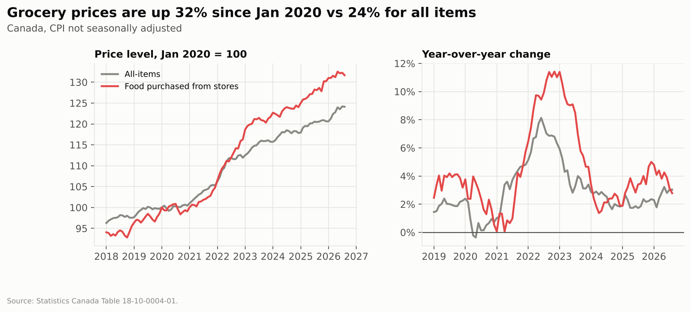
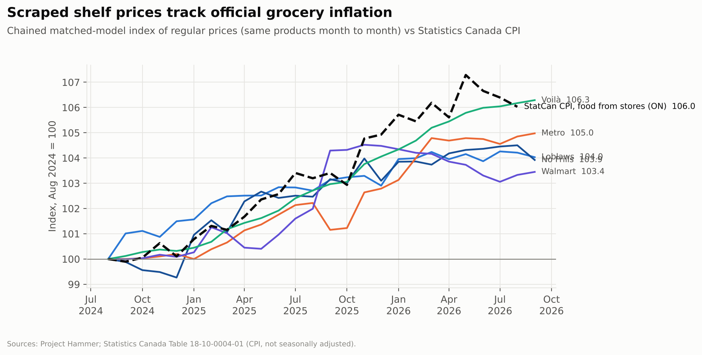
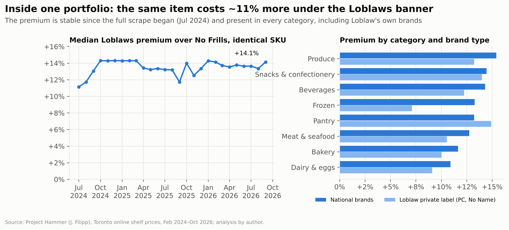
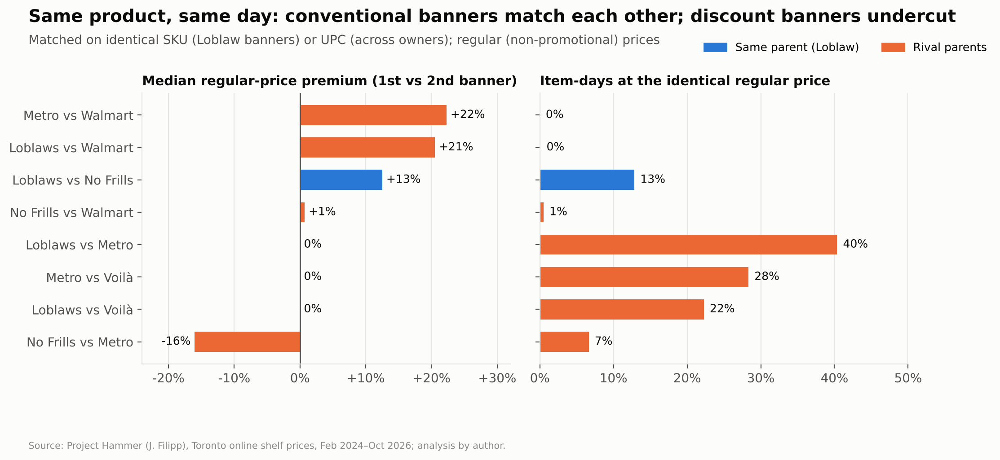
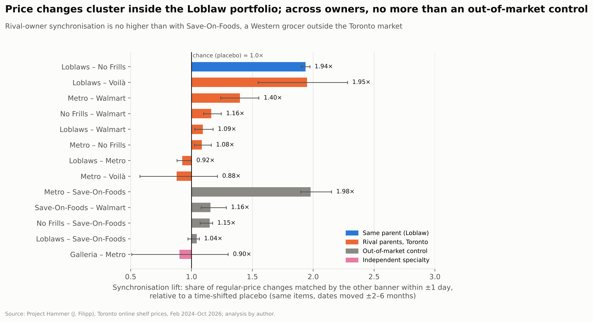
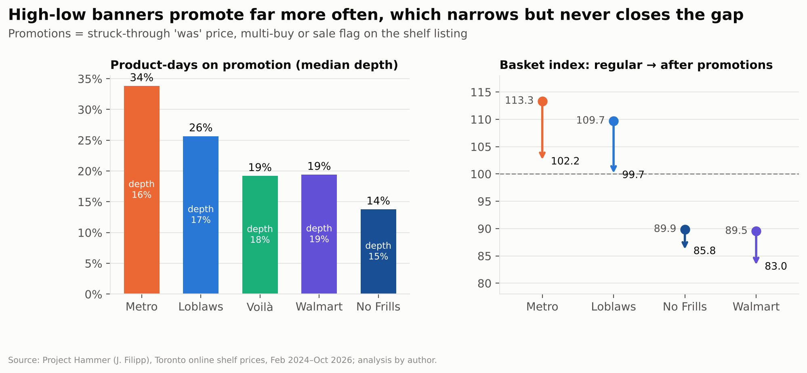
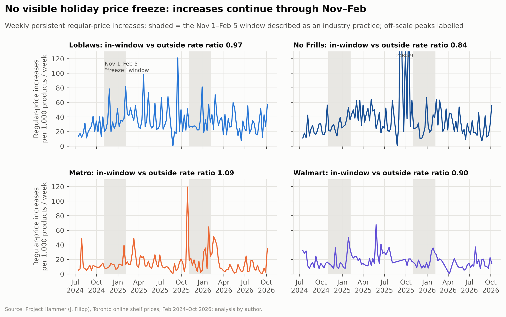
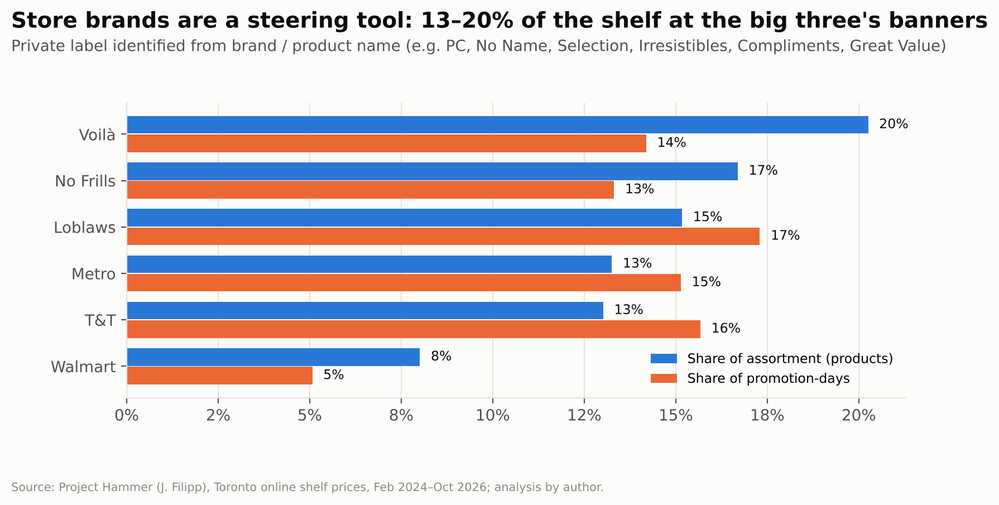
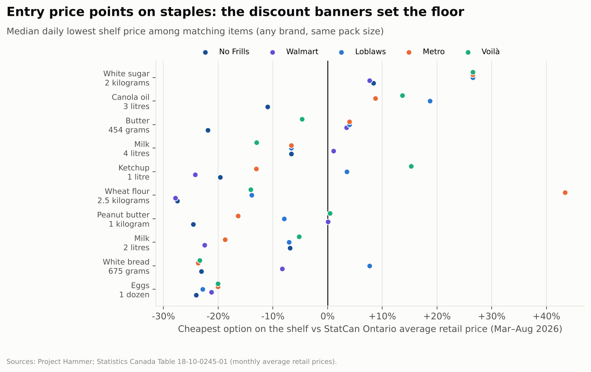

# Same Owner, Different Shelf

**A consumer-behaviour perspective on pricing across Canada's grocery banners**

| | |
|---|---|
| **Prepared for** | Leadership team: strategy, category management and public affairs |
| **Prepared by** | Independent research project, University of Toronto |
| **Date** | October 2026 |
| **Evidence base** | 76.8M daily shelf-price observations for 8 Toronto banners (Project Hammer, 28 Feb 2024 to 12 Oct 2026); Statistics Canada CPI and average retail prices |

---

## 1. Executive summary

Canada's grocery market is often described as a contest between rival stores. The shelf-price data describe something different: **a small number of parent companies managing portfolios of banners that sort shoppers into price tiers.** Competition is visible *between* tiers. It is much weaker *within* them.

- **Two tiers, one basket.** On an identical basket of ~1,700 UPCs, Metro (113) and Loblaws (110) sit about 20 index points above No Frills (90) and Walmart (90). Loblaw owns a banner in both tiers.
- **The banner is a price signal.** The *same SKU* costs a median **12.5% more** at Loblaws than at its sister banner No Frills. 78% of 16,863 matched SKUs are dearer at Loblaws, and the premium appears in every category, including Loblaw's own PC and No Name brands.
- **Rival conventional banners share price points.** Loblaws and Metro charge the **identical regular price on 40% of matched item-days**. When both change an item's price, 29% of the time they land on the identical new price. Loblaws and Walmart almost never share a price (0.1% of item-days).
- **Timing coordination lives inside portfolios.** Loblaws and No Frills change identical SKUs within a day of each other **1.9× as often as chance**. Across the main rival-owner pairs (Loblaws, No Frills, Metro, Walmart) the lift is 0.9× to 1.4×, the same range as a Western grocer that does not operate in Toronto. That is consistent with common supplier costs, not day-to-day matching.
- **Promotions manage perception.** Conventional banners promote 26–34% of product-days (No Frills: 14%). Promotions trim their basket by about 9–10%, which narrows but never closes the gap to the discount tier.
- **No visible holiday price freeze.** A Nov 1–Feb 5 freeze described as "industry practice" does not show up on the shelf. Increase rates in the window are 0.84× to 1.09× the rest of the year at the four main Toronto banners, and no difference is statistically significant.

**So what.** A shopper who "switches to the cheaper store" to save money often stays inside the same corporate portfolio. A shopper comparing conventional banners finds little price difference to exploit. Market power in this setting is exercised less through overt price moves than through **pricing architecture**: tiered banners, shared price points, reference ("was") prices and store-brand placement.

---

## 2. Why this matters now

Grocery inflation has outpaced general inflation. Statistics Canada's CPI for *food purchased from stores* is up **31.7%** since January 2020, against **24.1%** for all items (August 2026). Meat is up 39.4%, and dairy and eggs 28.5%.

The Competition Bureau's 2023 *Retail Grocery Market Study* described a concentrated market led by five large chains (Loblaw, Sobeys/Empire, Metro, Costco and Walmart). It reported grocery gross margins up modestly, roughly one to two percentage points since 2017. Concentration of that kind raises a consumer question that the price level alone cannot answer: **when one company runs several banners, is a "cheaper store" a competitor or just a cheaper rung of the same ladder?**

---

## 3. The market structure shoppers navigate

Each large parent runs banners aimed at different value propositions. Banners marked \* are in the price data.

| Parent | Discount | Conventional | Specialty / premium | Online |
|---|---|---|---|---|
| **Loblaw** | No Frills\*, Real Canadian Superstore, Maxi | Loblaws\*, Zehrs, Fortinos, Provigo | T&T\* (acquired 2009) | PC Express |
| **Empire (Sobeys)** | FreshCo | Sobeys, Safeway, IGA, Foodland | Farm Boy, Longo's | Voilà\* |
| **Metro Inc.** | Food Basics, Super C | Metro\* | Adonis | metro.ca |
| **Walmart Canada** | Walmart\* (EDLP) | n/a | n/a | walmart.ca |

*Also observed: Galleria (independent Korean grocer) and Save-On-Foods (Pattison Food Group, Western Canada), which serve as out-of-market and independent comparisons. Banner lists are illustrative, not exhaustive.*

Five of the eight banners in the data belong to the three largest parents. Loblaw is unusually well covered: its conventional and discount banners share one product catalogue, so the two can be compared SKU for SKU.

---

## 4. Data and approach

| Step | What was done |
|---|---|
| **Collect** | Project Hammer's daily scrape of 8 banners' websites (in-store-pickup prices for a Toronto neighbourhood): 76.8M records. Plus StatCan Tables 18-10-0004-01 (CPI) and 18-10-0245-01 (average retail prices). |
| **Clean** (Python + DuckDB) | Parsed multi-buy ("2/$7") and conditional deals ("sale $3.50 MIN 2"). Repaired 123k cents-scaled prices. Separated the **regular** price from the **promotional** price. Removed out-of-range values. Collapsed to 64.5M banner-product-days. |
| **Match** | Identical items via shared SKU (Loblaws ↔ No Frills) or UPC across owners. Variable-weight items were excluded. |
| **Measure** | Identical-item gaps; a basket price index; 384k *persistent* regular-price changes (temporary cuts reversed within 14 days were excluded) tested for synchronisation against a time-shifted placebo; promotion intensity; and a freeze-window test. |
| **Translate** (Excel + deck) | Workbook with live formulas and charts; this memo and an executive deck. |

**Validation.** The scraped banners' regular prices rose 3.4% to 6.3% between August 2024 and September 2026. StatCan's CPI for food from stores rose 6.0% in Ontario over the same window. The scraped data track the official measure.

---

## 5. Findings

### 5.1 One basket, two price tiers

The price index covers ~1,700 identical UPCs that all four mainstream banners stocked in the same month. Prices sort cleanly into two tiers:

| Banner | Regular-price index | After promotions | Realised promo saving |
|---|---|---|---|
| Metro | 113.3 | 102.2 | 9.8% |
| Loblaws | 109.7 | 99.7 | 9.1% |
| No Frills | 89.9 | 85.8 | 4.5% |
| Walmart | 89.5 | 83.0 | 7.3% |

*Index: 4-banner regular-price average = 100, Aug 2024 to Oct 2026.*

The gap between tiers (~20 points) dwarfs the gap within them (~3.6 points between Metro and Loblaws; 0.3 between No Frills and Walmart). **Loblaw occupies both tiers.**

### 5.2 Inside one portfolio, the banner itself carries a 12.5% premium

Loblaws and No Frills share a catalogue, which makes them the cleanest test of portfolio pricing.

- The median identical SKU costs **12.5% more** at Loblaws (10.0% after promotions). **77.7%** of SKUs are dearer at Loblaws, 17.0% are identical and 5.3% are cheaper.
- The premium varies item by item. In the latest quarter the interquartile range ran from **+5% to +26%**, and 36% of SKUs carried a premium above 20%.
- The premium has been stable since the full scrape began in July 2024. It is present in every category, and Loblaw's own brands carry a similar premium (for example, dairy & eggs: +10.9% national brands vs +9.1% private label).

**Interpretation.** The shopper pays for the store environment, assortment and convenience, not for the product. Trading down from Loblaws to No Frills is a genuine saving, but the spend stays in the same portfolio. This is the textbook "premium protects margin, discount defends volume" structure.

### 5.3 Rival conventional banners land on identical price points

| Pair (identical UPC/SKU, same day) | Median regular premium | Item-days at identical price |
|---|---|---|
| Loblaws vs Metro (rivals, conventional) | 0.0% | **40.4%** |
| Metro vs Voilà (rivals, conventional) | 0.0% | 28.3% |
| Loblaws vs Voilà (rivals, conventional) | 0.0% | 22.3% |
| Loblaws vs No Frills (same parent) | +12.5% | 12.8% |
| No Frills vs Walmart (rivals, discount) | +0.7% | 0.5% |
| Loblaws vs Walmart (across tiers) | +20.5% | 0.1% |
| Metro vs Walmart (across tiers) | +22.3% | 0.0% |

When Loblaws and Metro both change the same item's regular price within two weeks, **28.8%** of the time they land on the *identical* new price (Loblaws–Walmart: 0.0%). The discount banners No Frills and Walmart sit at almost the same level (+0.7%) but rarely at the same exact price. They track each other closely without sharing price points.

**Read with care.** Shared price points are consistent with tacit coordination. They are equally consistent with manufacturer-suggested retail prices and common list-price changes. The data cannot separate the two. For the shopper the effect is the same either way: **comparison shopping between conventional banners yields little.**

### 5.4 Timing: coordination lives inside portfolios, not across them

The test asks how often a regular-price change at banner A is matched by a same-direction change at banner B within ±1 day. The result is divided by the same rate when A's dates are shifted ±2–6 months (the placebo); a lift of 1.0 means chance.

| Pair | Lift (±1 day) |
|---|---|
| Loblaws – No Frills (same parent) | **1.94×** |
| Metro – Walmart | 1.40× |
| No Frills – Walmart | 1.16× |
| Loblaws – Walmart | 1.09× |
| No Frills – Metro | 1.08× |
| Loblaws – Metro | 0.92× |
| *Metro – Save-On-Foods (out-of-market control)* | *1.98×* |
| *No Frills – Save-On-Foods (control)* | *1.15×* |
| *Loblaws – Save-On-Foods (control)* | *1.04×* |

- Inside Loblaw, 6.6% of Loblaws' changes are matched by No Frills within the same day, against 3.1% under the placebo.
- Pairs involving Voilà are too noisy to read. Fewer than 3% of changes find a match within a day, so lifts swing from 0.9× to 2.0× with wide confidence intervals.
- Across rival owners, synchronisation is no higher than with Save-On-Foods. Save-On-Foods does not compete in Toronto, so it shares only national supplier cost shocks with these banners. The cross-owner co-movement is therefore best explained by **common costs, not reaction to rivals**.
- **No banner leads.** In paired Loblaws–Metro changes, Loblaws moves first 42% of the time and Metro 47%.
- **Prices change on a weekly rhythm.** 69% of Loblaws', 64% of No Frills' and 63% of Metro's regular-price changes first appear on a Thursday, in step with the flyer cycle.

### 5.5 Promotions: reference prices do the persuading

| Banner | Product-days on promotion |
|---|---|
| Metro | 33.8% |
| Loblaws | 25.7% |
| Walmart | 19.4% |
| Voilà | 19.2% |
| No Frills | 13.8% |

The conventional banners run high-low pricing: a high regular price and frequent "was/now" promotions. The discount banners lean on everyday low prices. Promotion *timing* coincides only modestly. On the same item and day, the chance that B is on promotion when A is rises 1.14–1.40× for rival pairs and 1.43× inside Loblaw, against 1.12–1.20× with the out-of-market control. That pattern points to manufacturer-funded promotion calendars more than retaliation.

**Interpretation.** A struck-through price works as an anchor: the higher the regular price, the larger the visible "saving". High-low pricing lets conventional banners keep a competitive *price image* without moving the regular price that anchors the shopper's sense of value.

### 5.6 Testing a claim: no measurable holiday "price freeze"

Metro has described a Nov 1–Feb 5 freeze on private-label and national-brand prices as "industry practice" (as quoted on the Project Hammer site). If that held for shelf prices, regular-price increases would drop sharply in the window. Across two winters (2024-25 and 2025-26), they do not:

| Banner | Increase rate in window vs rest of year | Mann-Whitney p (weekly rates) |
|---|---|---|
| Loblaws | 0.97× | 0.94 |
| No Frills | 0.84× | 0.25 |
| Metro | 1.09× | 0.30 |
| Walmart | 0.90× | 0.17 |
| Voilà | 1.59× | 0.41 |

Any freeze may apply to supplier cost increases or to specific items rather than to shelf prices. **Shoppers should not assume holiday prices are protected.**

### 5.7 Store brands steer the shelf

Private label makes up 15–20% of the assortment at the big three's banners (Voilà 20.3%, No Frills 16.7%, Loblaws 15.2%, Metro 13.3%) and 8.0% at Walmart. At Loblaws, store brands take a *larger* share of promotion-days (17.3%) than of the shelf. Promotions there tilt attention toward the retailer's own brands. PC and No Name also appear at different prices across Loblaw's banners, giving one brand a good-better-best ladder *across* stores as well as within them.

### 5.8 Staples: the discount banners set the floor

For ten staples, the cheapest option on each banner's shelf (median daily, Mar–Aug 2026) was compared with StatCan's Ontario average retail price. No Frills or Walmart set the lowest entry price on most staples: butter 454 g $4.50 at No Frills vs a $5.76 Ontario average, and ketchup 1 L $3.48 at Walmart vs $4.59. Four-litre milk is the exception, priced at an identical **$6.44 at Loblaws, Metro and No Frills**. *Entry prices are compared with an all-brand, all-outlet average, so they are expected to sit below it.*

---

## 6. Consumer-behaviour interpretation

The price evidence becomes commercially meaningful once shopper decision-making is taken into account. Shoppers do not compare 1,700 items; they choose stores using heuristics. Four mechanisms turn the portfolio structure into durable pricing power:

1. **Choice-set illusion.** Many banner names signal many competitors. Five of the eight banners here belong to three parents. Switching from Loblaws to No Frills feels like rewarding a competitor, but it keeps the spend in one portfolio.
2. **Anchoring and reference prices.** The conventional tier's regular price sets the shopper's internal reference. "Was" prices and the discount tier are both judged against it, so both feel like savings.
3. **Tier sorting (the compromise effect).** Shoppers self-select into good, better or best banners by value proposition rather than comparing identical items. The 12.5% banner premium is paid for environment and convenience, and the portfolio captures shoppers at every willingness to pay.
4. **Price image over price facts.** Shoppers rely on a banner's overall price image. Identical price points among conventional rivals remove the signal that would reward comparison shopping where it matters most.

None of these mechanisms requires explicit coordination. **The architecture does the work.**

---

## 7. Implications and recommendations

| Stakeholder | Recommendation |
|---|---|
| **Policymakers & regulators** | Assess concentration at the *parent* level; the banner is a marketing device. Strengthen unit-pricing and "was"-price rules so reference prices are verifiable. Use open scrape data such as Project Hammer for continuous monitoring of identical-item gaps and shared price points. |
| **Challengers & independents** | Position against the conventional tier, where rivals share price points and the gap to the discount tier is ~20 points. Compete on transparent everyday pricing rather than high-low. Target categories with the widest banner premiums (produce, beverages, snacks: +14–15%). |
| **National-brand manufacturers** | Suggested retail prices become shared focal points among conventional banners, so set them deliberately. Plan trade spend by tier rather than by banner. Monitor private label's growing share of promotion-days. |
| **Shoppers & consumer advocates** | Compare across *owners*, not just banners. Treat "was" prices as anchors, not as evidence of savings. The same SKU costs a median 12.5% more at Loblaws than at No Frills. |

---

## 8. Limitations

- **Coverage.** Online in-store-pickup prices for one Toronto neighbourhood; not every store, region or in-store price. Save-On-Foods prices are Western Canadian and serve only as a control. Food Basics, FreshCo, Sobeys stores and Costco are not in the scrape.
- **No costs or volumes.** Margins and market shares are not observed, so statements about margin protection describe pricing *structure*, not profitability.
- **Descriptive, not causal.** Synchronised or identical prices are consistent with coordination but also with common supplier costs and manufacturer-suggested prices. **Nothing here is a finding of collusion.**
- **Matching error.** The source's UPCs for Loblaw banners were fuzzy-matched. SKU matching (Loblaws ↔ No Frills) is exact; cross-owner UPC matches carry some error.
- **Classification.** Private-label and category flags come from transparent keyword rules (see `src/config.py`) and are approximate.

## 9. Next steps

1. **Shopper survey** (n ≈ 1,000 GTA shoppers) to measure awareness of banner ownership, perceived price image and trade-down paths. This would test the behavioural mechanisms directly rather than infer them.
2. **Link to supplier list-price changes** to separate cost pass-through from strategic moves.
3. **Extend coverage** to the Empire and Metro discount banners (FreshCo, Food Basics) as data allow.
4. **Natural experiments:** the Grocery Code of Conduct and any unit-pricing reforms.

---

## Appendix A: Methods detail

**Cleaning log** (`outputs/tables/00_cleaning_log.csv`): 76.8M raw observations → 75.9M after dropping unparseable and out-of-range prices → 64.5M banner-product-days → 594.9k regular-price changes, of which 384.4k are persistent.

**Definitions**

- *Regular price:* the shelf price when no promotion is running. On promotion, it is the struck-through "was" price, or the single-unit price for conditional multi-buy deals.
- *Persistent change:* a regular-price change of at least 1% and at least $0.05, dated to within 3 days, and not reversed within 14 days. This is in the spirit of the sales filters in Nakamura & Steinsson (2008).
- *Identical-item gap:* for each matched item, the median daily log price ratio over common days (minimum 14 days), then summarised across items.
- *Basket index:* geometric mean price relative to the four-banner mean, on UPCs that Loblaws, No Frills, Metro and Walmart all stocked in the month.
- *Synchronisation lift:* the share of A's persistent changes matched by a same-direction change at B within ±k days (B observed on that day), divided by the same share with A's dates shifted by ±63, 91, 126 and 182 days. Reported as the average of both directions.
- *Freeze test:* persistent increases per 1,000 active products per week, comparing weeks whose midpoint falls between Nov 1 and Feb 5 with all other weeks (Jul 2024 to Oct 2026). Weekly rates are compared with a Mann-Whitney U test.

## Appendix B: Sources

- Filipp, J. (2024–2026). *Project Hammer: Canadian grocery price data.* jacobfilipp.com/hammer; projecthammer.org.
- Statistics Canada. Table 18-10-0004-01, *Consumer Price Index, monthly, not seasonally adjusted.* doi.org/10.25318/1810000401-eng.
- Statistics Canada. Table 18-10-0245-01, *Monthly average retail prices for selected products.* doi.org/10.25318/1810024501-eng.
- Competition Bureau Canada (2023). *Canada needs more grocery competition: Retail Grocery Market Study Report.*
- Nakamura, E. & Steinsson, J. (2008). Five facts about prices: A reevaluation of menu cost models. *Quarterly Journal of Economics*, 123(4).
- Corporate disclosures of Loblaw Companies, Empire Company and Metro Inc. (banner ownership).

## Appendix C: Reproducibility

Every number in this memo is produced by the pipeline in this repository (`make data && make all`). See the README. The workbook `outputs/grocery_oligopoly_analysis.xlsx` holds every table behind this memo, with live formulas for the summary measures.
